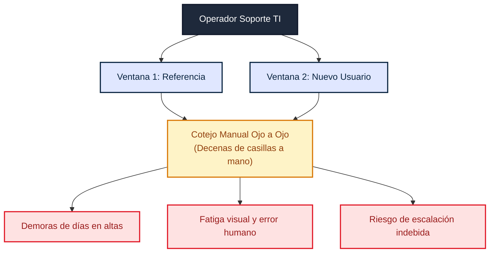
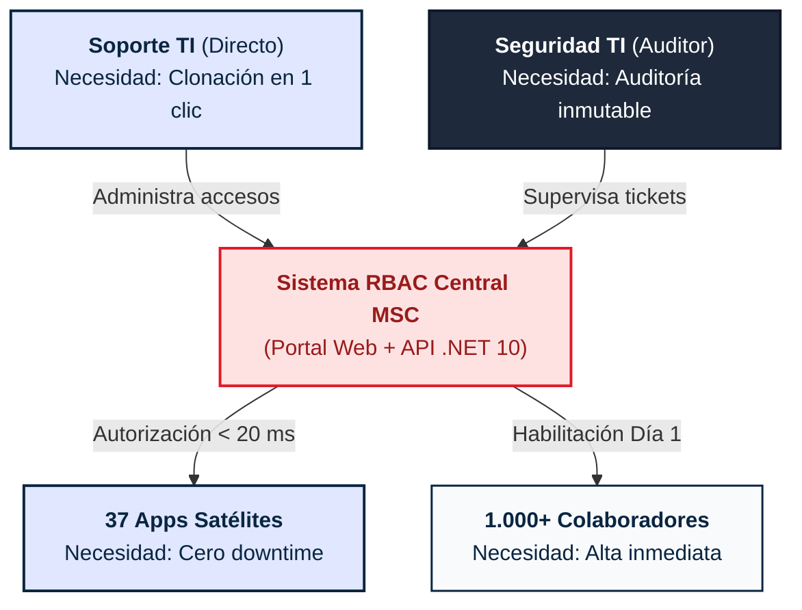
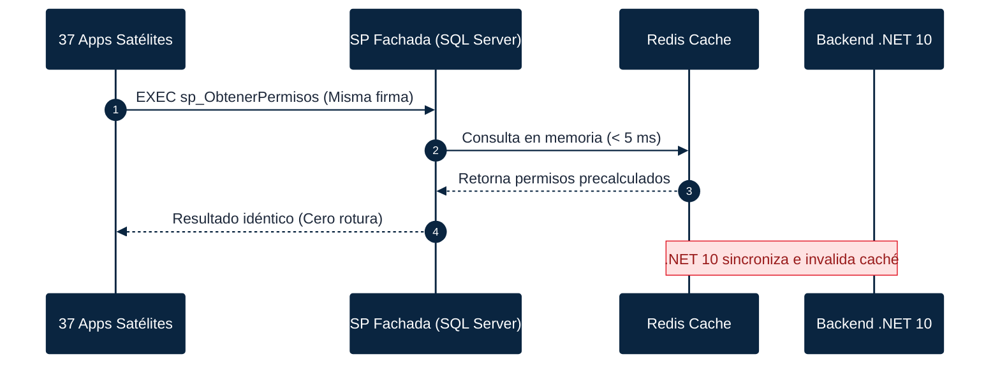

  
Proyecto Integrador · TIHV43 · Evaluación 1

  
    

    Código MSC-01
  

# Modernización Sistema RBAC MSC Chile

Propuesta Técnica de Transición y Plataforma Web de Control de Accesos

  

    

      1.000+
      

    

    
Usuarios Activos en Plataforma

  

  

    

      37
      

    

    
Sistemas Satélites Dependientes

  

  

    

      94%
      

    

    
Dependencia Crítica Operacional

  

  

    

      

      Equipo Consultor
    

    

      Pablo Herrera · Jesús Rincón · Sabrina Silva 
      Abraham Tapia · Catalina Cubillos · Jose Morales
    

  

  

    

      

      Datos Académicos
    

    

      <b>Asignatura:</b> Proyecto Integrador (TIHV43) 
      <b>Docente Guía:</b> Profesor Edgar López · INACAP
    

  

<!--
Speaker Notes:
"Muy buenos días profesor Edgar López y compañeros. Imaginen una empresa naviera global como MSC que mueve miles de contenedores diarios por los puertos de nuestro país. Para que un camión ingrese a muelle, se emita una factura o se libere una carga, intervienen cerca de mil colaboradores a través de 37 sistemas informáticos distintos. Lo alarmante es esto: el noventa y cuatro por ciento de esas aplicaciones dependen críticamente de un único sistema para saber si un trabajador tiene o no permiso de operar. Hoy venimos a presentar el diagnóstico formal para la modernización del sistema de control de accesos de MSC Chile, un proyecto donde la continuidad operativa no es una opción, sino una exigencia vital para el negocio."
-->

---

  
Diagnóstico As-Is · Dolor Operativo

  
    
 Diagnóstico Crítico
  

#  1 · La Radiografía del Problema

  

    
 Diagrama de Falla Operativa: "Doble Ventana"
  

  

    <b class="text-brand-red-dark">Cero Abstracción:</b> 
    No existen perfiles por cargo. Se asigna permiso por permiso y aplicación por aplicación.
  

  

    <b class="text-brand-crimson">Pérdida de Automatización:</b> 
    La migración a Azure dejó sin efecto la detección automática de departamentos.
  

  

    <b class="text-brand-navy-dark">Impacto Operacional:</b> 
    Cuellos de botella de hasta 72 horas para habilitar puestos críticos en agencias y puertos.
  

<!--
Speaker Notes:
"¿Cuál es el verdadero problema que detectamos? La herramienta actual no ha fallado a nivel de caídas de servidor, pero su diseño operativo es insostenible. Como muestra el diagrama de flujo, cuando un operador de soporte necesita darle a un nuevo trabajador los mismos accesos que a su compañero de área, hoy está forzado a abrir la aplicación de escritorio dos veces, poner una ventana al lado de la otra y cotejar manualmente a ojo, casilla por casilla, decenas de permisos. Esto genera demoras injustificables para el negocio y un peligro constante de error humano o escalación involuntaria de privilegios. A esto se suma que la migración a la nube en Azure dejó sin efecto la detección automática de departamentos. Para entender cómo transformar este dolor en requerimientos precisos, le cedo la palabra a Jesús Rincón."
-->

---

  
Levantamiento de Requerimientos · Entrevista Técnica

  
    
 Entrevista con Cliente
  

#  2 · Hechos vs. Restricciones

  

    
 Hechos Confirmados
  

  <ul class="space-y-1.5 text-ink/80 text-[11px]">
    <li>• <b>Stack Base:</b> .NET Legacy + SQL Server relacional.</li>
    <li>• <b>Infraestructura:</b> Uso exclusivo en red Citrix vía Microsoft Edge.</li>
    <li>• <b>Activos Disponibles:</b> Código fuente legado y BD anonimizada entregados para el equipo.</li>
    <li>• <b>Perfil de Uso:</b> Portal interno exclusivo para equipo de TI (sin necesidad de móviles).</li>
  </ul>

  

    
 Necesidades de TI
  

  <ul class="space-y-1.5 text-ink/80 text-[11px]">
    <li>• <b>Modernización Web:</b> Reemplazar cliente desktop por interfaz reactiva.</li>
    <li>• <b>Perfiles por Cargo:</b> Asignación masiva en 1 paso por función.</li>
    <li>• <b>Clonación Guiada:</b> Comparador de permisos en pantalla única.</li>
    <li>• <b>Bitácora Estricta:</b> Registro con autorizador y ticket de respaldo.</li>
  </ul>

  

    
 La Restricción Dorada
  

  

    CERO DOWNTIME EN PUERTO: Ningún cambio puede romper las 37 aplicaciones satélites.
  

  

    Se autoriza rediseñar la BD, pero los Procedimientos Almacenados consumidos por los satélites deben responder <b>con idéntica firma y resultado</b>.
  

  

  <b>Conclusión del Diagnóstico:</b> No se requiere app móvil ni acceso público; el foco es alta velocidad operativa dentro de Citrix y estabilidad absoluta de APIs.

<!--
Speaker Notes:
"Gracias Pablo. Al reunirnos con el cliente y realizar las entrevistas técnicas y de negocio, logramos separar los deseos de las restricciones no negociables. El cliente fue categórico: el sistema debe transformarse en una solución web moderna, pero está destinado exclusivamente al equipo interno de TI dentro de la red corporativa Citrix, utilizando Microsoft Edge. Por lo tanto, no requerimos interfaces para móviles ni acceso público. Pero el hallazgo más determinante es la restricción dorada de compatibilidad: tenemos libertad para rediseñar la base de datos y optimizarla, pero los procedimientos almacenados que hoy consumen los 37 sistemas satélites deben seguir funcionando de forma idéntica. Si un cambio nuestro altera una columna o firma de esos procedimientos, detenemos la operación de MSC."
-->

---

  
Stakeholders · Análisis de Dominio

  
    
 Ecosistema de Usuarios
  

#  2 · Mapa de Actores y Flujo de Interacción

  

    
 Matriz de Relación con el Sistema Central
  

  

    <b class="text-brand-red-dark">Soporte TI:</b> 
    Agilidad operativa sin abrir dos ventanas paralelas.
  

  

    <b class="text-brand-navy-dark">Seguridad:</b> 
    Trazabilidad de auditoría: quién autorizó, cuándo y bajo qué ticket.
  

  

    <b class="text-brand-crimson">Satélites:</b> 
    Continuidad operacional absoluta y respuesta ultra rápida.
  

  

    <b class="text-emerald-900">1.000+ Colaboradores:</b> 
    Alta inmediata en su primer día laboral sin demoras burocráticas.
  

<!--
Speaker Notes:
"Con estas reglas claras, estructuramos a los cuatro actores del ecosistema como muestra este mapa interactivo. El usuario directo es el operador de TI, cuyo dolor es la lentitud del proceso manual. El responsable es la Jefatura de Seguridad, que no puede auditar con precisión quién autorizó una excepción ni bajo qué ticket formal. Los interesados técnicos son los equipos de los 37 sistemas satélites, que no tienen tiempo ni presupuesto para reprogramar sus aplicaciones. Y finalmente, los beneficiarios son los mil trabajadores de MSC que necesitan sus accesos a tiempo. ¿Cómo convertimos estas necesidades en valor concreto para el negocio? Mi compañera Sabrina Silva nos presentará las Historias de Usuario seleccionadas."
-->

---

  
Especificación Ágil · Historias de Usuario

  
    
 Historias Clave
  

#  3 · Historias de Usuario Operativas

  

    HU01 · Asignación por Cargo
  

  

    "Como Soporte TI, quiero asignar un perfil de cargo predefinido para dar de alta accesos en un solo paso."
  

  

    <b>Impacto:</b> Elimina la selección manual casilla por casilla. Un facturador recibe de inmediato el set estándar de sus aplicaciones.
  

  

    HU02 · Clonación Ágil (1 Clic)
  

  

    "Como Soporte TI, quiero comparar y clonar permisos entre usuarios en una sola pantalla para erradicar la doble ventana."
  

  

    <b>Impacto:</b> Vista de pantalla dividida con diferenciador visual. Clona atributos validados sin errores de cotejo.
  

  

    HU03 · Excepciones Controladas
  

  

    "Como Soporte TI, quiero otorgar permisos temporales fuera de cargo para resolver casos puntuales sin romper el estándar."
  

  

    <b>Impacto:</b> Permite flexibilidad (ej. secretaria de gerencia) exigiendo motivo obligatorio y ticket de respaldo.
  

  <b class="text-emerald-800">Principio de Menor Privilegio:</b> El cargo define la línea base institucional. Cualquier atribución extra no ensucia el perfil global, sino que queda auditada como excepción individual trazable.

<!--
Speaker Notes:
"Muchas gracias Jesús. El corazón de nuestro diagnóstico fue asegurar que cada historia de usuario resuelva un dolor real de la operación. Seleccionamos tres historias operacionales fundamentales: Primero, la Historia de Usuario 1 permite asignar permisos por cargo. Si ingresa un 'Facturador Marítimo', el operador selecciona ese perfil y el sistema otorga de golpe todas las atribuciones en las aplicaciones pertinentes. Segundo, la Historia de Usuario 2 ataca directamente el peor dolor levantado: la clonación de permisos. En una sola vista dividida, el operador selecciona al usuario de referencia y al nuevo, ve las diferencias y clona todo en un clic. Adiós a las dos ventanas abiertas en paralelo. Y tercero, la Historia 3 maneja excepciones: permite dar permisos extraordinarios pero etiquetándolos con un motivo obligatorio."
-->

---

  
Criterios de Aceptación & Gobernanza

  
    
 Estándar y Auditoría
  

#  3 · Gobernanza y Control Técnico

  

    
 HU04 · Auditoría Inmutable
  

  

    Trazabilidad integral de cada alta, baja o modificación de permisos.
  

  

    
• Registro automático: operador, IP, fecha y hora.

    
• Campo obligatorio de motivo o ticket formal.

    
• Adjunto digital del correo o aprobación.

  

  

    
 HU05 · API Satélites (&lt; 20 ms)
  

  

    Endpoint REST moderno para consulta de permisos efectivos por usuario.
  

  

    
• Latencia P95 &lt; 20 ms garantizada.

    
• Respuesta serializada en JSON plano.

    
• Desacoplamiento de llamadas pesadas a BD.

  

  

    
 HU06 · Catálogo Autónomo
  

  

    CRUD desacoplado de cargos y departamentos administrado por TI.
  

  

    
• Independencia de errores de Azure AD.

    
• Normalización de nombres de cargos.

    
• Mapeo 1:N con aplicaciones satélites.

  

  

  <b>Gobernanza TI:</b> Los módulos garantizan que la velocidad operativa nunca comprometa la seguridad, trazabilidad ni el cumplimiento normativo exigido por MSC Global.

<!--
Speaker Notes:
"Pero una solución corporativa no solo debe ser ágil; debe ser segura y gobernable. En la Historia de Usuario 4 establecimos criterios estrictos de auditoría: ningún permiso puede ser creado o modificado sin que el sistema capture de forma inmutable quién fue el operador, la fecha exacta y el correo o ticket de respaldo adjunto. Además, en la Historia 5, definimos que el nuevo endpoint para satélites debe responder en menos de 20 milisegundos, para no ralentizar las operaciones en muelle. Y con la Historia 6, devolvemos a TI el control de su catálogo de departamentos sin depender de los datos mal formateados de Microsoft Graph. Para ver cómo estos requerimientos se formalizan bajo estándares internacionales, dejo con ustedes a Abraham Tapia."
-->

---

  
Ingeniería de Requerimientos · Priorización

  
    
 Priorización MoSCoW
  

#  4 · Requerimientos Funcionales (MoSCoW)

  

    
 MUST HAVE (Críticos e Irrenunciables)
  

  

    

      <b>RF01 · Perfiles de Cargo:</b> Creación y edición de paquetes estándar de permisos.
    

    

      <b>RF02 · Asignación Masiva:</b> Vinculación inmediata de usuario con perfil.
    

    

      <b>RF03 · Clonación Ágil:</b> Copia y comparación en interfaz única de 1 clic.
    

    

      <b>RF04 · Excepciones:</b> Permisos temporales fuera de cargo con motivo.
    

    

      <b>RF05 · API Satélites:</b> Consulta de permisos efectivos en &lt; 20 ms.
    

    

      <b>RF06 · Auditoría Inmutable:</b> Log histórico protegido con respaldo.
    

  

  
  

    <b>RF08 · Fachada de SPs:</b> Capa de compatibilidad SQL Server para las 37 aplicaciones.
  

  

    

      
 SHOULD HAVE (Deseables)
    

    

      <b>RF07 · Catálogo Desacoplado:</b> Módulo administrativo autónomo para jerarquías y áreas sin depender de Azure.
    

  

  

    

      
 WON'T HAVE (Fuera de Alcance)
    

    

      <b>Sincronización Bidireccional con RRHH:</b> Se descarta integración automática con sistemas externos para blindar los plazos semestrales.
    

  

<!--
Speaker Notes:
"Gracias Sabrina. En ingeniería de requerimientos, priorizar es decidir qué hace viable un proyecto. Siguiendo la metodología MoSCoW, clasificamos siete requerimientos como 'Must Have'. Entre ellos destacan el RF03 para la clonación inmediata de accesos, el RF06 para la bitácora inalterable y el RF08, que obliga al backend a convivir con los procedimientos almacenados de base de datos actuales. Dejamos deliberadamente como un 'Should Have' la administración avanzada de departamentos y fuera del alcance cualquier integración automática con sistemas de Recursos Humanos, protegiendo así los tiempos de entrega del semestre."
-->

---

  
Estándar Internacional · Calidad de Software

  
    
 Norma ISO/IEC 25010
  

#  4 · Requerimientos No Funcionales (ISO 25010)

  

    
 Rendimiento
  

  
RNF01 & RNF02

  <ul class="space-y-1 text-ink/80 text-[11px]">
    <li>• <b>Latencia P95 &lt; 20 ms</b> en consultas de autorización satélite.</li>
    <li>• <b>Descarga de Cómputo:</b> Traslado de lógica pesada desde SQL Server hacia C#.</li>
  </ul>

  

    
 Seguridad
  

  
RNF03 & RNF04

  <ul class="space-y-1 text-ink/80 text-[11px]">
    <li>• <b>Autenticación OIDC</b> en entorno corporativo Citrix.</li>
    <li>• <b>Auditoría Append-Only:</b> Tablas de solo lectura (prohibido UPDATE y DELETE).</li>
  </ul>

  

    
 Compatibilidad
  

  
RNF05

  <ul class="space-y-1 text-ink/80 text-[11px]">
    <li>• <b>100% Retrocompatibilidad</b> con firmas históricas de SPs consumidos.</li>
    <li>• Ninguna modificación requerida en las 37 aplicaciones cliente.</li>
  </ul>

  

    
 Usabilidad
  

  
RNF06

  <ul class="space-y-1 text-ink/80 text-[11px]">
    <li>• <b>Optimizado para Edge</b> sobre sesiones remotas de Citrix.</li>
    <li>• Interfaz reactiva fluida sin recargas completas de ventana.</li>
  </ul>

  

    

    <b>Compromiso de Calidad:</b> Garantía de continuidad operacional, latencia submilisegundo y cumplimiento de auditoría global.
  

  100% Verificable

<!--
Speaker Notes:
"Un buen diagnóstico no solo define qué hace el software, sino cómo debe comportarse. Aplicando la norma internacional ISO 25010, definimos requerimientos no funcionales muy rigurosos. En rendimiento, exigimos un tiempo de respuesta menor a 20 milisegundos para las consultas de los satélites. Pero la decisión más potente de ingeniería radica en el RNF02: hoy la base de datos está estresada porque ejecuta cálculos pesados en procedimientos almacenados sin índices. Nuestro requerimiento exige trasladar toda esa lógica a código C#, aliviando el motor de datos. En seguridad, garantizamos que la auditoría sea 'Append-Only': nadie, ni siquiera un administrador, podrá modificar o borrar un registro histórico. ¿Cómo se implementa esto a nivel de arquitectura y código? Mi compañera Catalina Cubillos nos explicará el diseño To-Be."
-->

---

  
Transición · Restricciones y decisiones preliminares

  
    
 Continuidad operativa
  

#  5 · Modernizar sin alterar los contratos actuales

  

    

      
 Contexto actual
    

    

      Sistema legado sobre .NET y SQL Server. El equipo de TI lo utiliza dentro de Citrix con Microsoft Edge.
    

  

  

    

      
 Restricción del cliente
    

    

      Los 37 sistemas satélite consumen procedimientos almacenados. Se debe conservar su firma y resultado, sin modificar esas aplicaciones.
    

  

  

    

      
 Decisión preliminar
    

    

      Enfocar el proyecto en un portal web interno para administrar accesos y perfiles. La tecnología concreta queda por definir.
    

  

  

  

    <b class="text-brand-red-dark">Pendiente de validar:</b> alternativas de arquitectura e integración con el código legado y el esquema de base de datos anonimizado entregados al equipo. En esta EVA definimos el problema y sus límites; el diseño técnico corresponde a una etapa posterior.
  

<!--
Speaker Notes:
"Gracias Abraham. En esta etapa no estamos cerrando una arquitectura. Partimos de lo levantado con el cliente: el sistema actual se apoya en .NET y SQL Server, y el equipo de TI lo usa dentro de Citrix con Microsoft Edge. La restricción principal es la continuidad: 37 sistemas satélite consumen procedimientos almacenados y se debe mantener su firma y resultado, sin modificar esas aplicaciones. A partir de esa necesidad, proponemos centrar el alcance en un portal web interno para administrar accesos y perfiles. La tecnología concreta y el diseño de integración quedan pendientes; deberán decidirse tras revisar el código legado y el esquema anonimizado que recibió el equipo, y comprobar que la compatibilidad se mantiene. En la siguiente diapositiva revisaremos los riesgos relacionados con los sistemas satélite y los controles que debemos considerar."
-->
---

  
Estrategia de Coexistencia · Patrón Fachada

  
    
 Continuidad Operacional
  

#  5 · Coexistencia con Satélites y Riesgos

  

    
 Flujo del Patrón "SP Fachada": Cero Rotura
  

  

    

      

      Riesgo 1: Caída de Satélites
    

    

      <b>Control:</b> Tests de regresión automatizados sobre contratos de SPs.
    

  

  

    

      

      Riesgo 2: Escalación de Accesos
    

    

      <b>Control:</b> RBAC estricto interno y autenticación corporativa OIDC.
    

  

  

    

      

      Riesgo 3: Sobrecarga en BD
    

    

      <b>Control:</b> Cómputo trasladado a C# y caché selectiva en Redis.
    

  

<!--
Speaker Notes:
"¿Cómo resolvemos el gran dilema de no romper las 37 aplicaciones existentes mientras modernizamos la base de datos? Como pueden ver en este diagrama de secuencia, aplicamos el patrón fachada: los procedimientos almacenados que los satélites ya conocen seguirán existiendo en SQL Server con exactamente los mismos nombres y parámetros, pero ya no ejecutarán consultas lentas ni bucles pesados; simplemente leerán de tablas precalculadas y de Redis en memoria. Con esto logramos tres victorias: la base de datos se descarga, los satélites siguen operando sin enterarse del cambio y la seguridad queda blindada bajo autenticación corporativa. Para explicarnos cómo garantizamos la viabilidad del proyecto y sus límites, le doy el pase a Jose Morales."
-->

---

  
Planificación Ágil · Seguridad de Pruebas

  
    
 Estrategia de Entrega
  

#  6 · Viabilidad, Datos Dummy y Alcance

  

    
 Metodología y Pruebas con Datos Dummy
  

  

    <b>Entorno Seguro Replicado:</b> MSC prohíbe el acceso a datos productivos. Replicaremos el esquema DDL entregado en SQL Server local con datos sintéticos:
  

  

    

      
50

      
Usuarios Dummy

    

    

      
10

      
Departamentos

    

    

      
37

      
Satélites Mocks

    

  

  

    

    <b>Pipeline Ágil:</b> GitHub Projects (Kanban) + Trunk-Based CI con integración continua.
  

  

    

    <b>Validación Continua:</b> Tests automáticos sobre contratos de SPs para garantizar cero rotura.
  

  

    

      
 Delimitación Honesta de Alcance
    

    

      

        
 Compromisos Clave (Dentro del Alcance)
      

      

        

          

          <b>Portal Web React SPA:</b> Interfaz fluida para soporte TI dentro de Citrix.
        

        

          

          <b>Backend .NET 10:</b> API REPR de alto rendimiento con aceleración en Redis.
        

        

          

          <b>Capa de Coexistencia:</b> Retrocompatibilidad total con SPs legados de satélites.
        

      

    

    

      

        
 Exclusiones Justificadas (Fuera del Alcance)
      

      

        

          

          <b>Código Satélites:</b> Cero alteración a las 37 aplicaciones existentes.
        

        

          

          <b>App Móvil:</b> Restringido exclusivamente a terminales de escritorio Citrix.
        

        

          

          <b>Sincronización RRHH:</b> Catálogo desacoplado para asegurar plazos del semestre.
        

      

    

  

<!--
Speaker Notes:
"Muchas gracias Catalina. Ningún diagnóstico es útil si no establece cómo se hará realidad. Dado que la política de MSC Chile prohíbe el acceso a datos productivos reales, nuestra estrategia de pruebas se basa en replicar el esquema DDL entregado por el cliente en un entorno de desarrollo local, poblándolo con un set de datos dummy representativo de 50 usuarios, 10 departamentos y las 37 aplicaciones. Esto nos permite simular el estrés del sistema sin poner en riesgo información corporativa sensible. Asimismo, delimitamos con estricta honestidad el alcance: queda fuera modificar las aplicaciones satélites o crear apps móviles innecesarias. Todo nuestro esfuerzo semestral está concentrado en entregar un portal administrativo veloz, seguro y totalmente compatible."
-->

---

  
Retorno de Inversión · Trazabilidad de Valor

  
    
 Retorno de Valor
  

#  6 · De la Necesidad al Valor del Negocio

  

    

      
 1. El Dolor Inicial
    

    

      
• Doble ventana abierta en paralelo.

      
• Cotejo manual casilla por casilla.

      
• Demoras de días en habilitar personal.

      
• Base de datos SQL Server estresada.

    

  

  Riesgo Alto

  

    

      
 2. La Solución Técnica
    

    

      
• Portal React optimizado para Edge.

      
• .NET 10 + FastEndpoints (REPR).

      
• Clonación y perfiles por cargo en 1 clic.

      
• Redis Cache + Fachada de SPs.

    

  

  Arquitectura Limpia

  

    

      
 3. Impacto en MSC Chile
    

    

      
• <b>Altas en segundos:</b> cero esperas.

      
• <b>Cero error humano:</b> validación estricta.

      
• <b>Auditoría 100% trazable:</b> quién y por qué.

      
• <b>Continuidad 24/7 en puerto asegurada.</b>

    

  

  Valor Estratégico

  

    <b class="text-brand-red-alt text-sm">Resultado del Diagnóstico:</b> Propuesta 100% viable, trazable y sin riesgo de interrupción operativa en puerto.
  

<!--
Speaker Notes:
"Para concluir, como ilustra esta cadena de valor, el mérito de este diagnóstico radica en su trazabilidad total: cada decisión técnica responde directamente a un dolor del cliente. Transformamos la frustrante doble ventana de soporte en una clonación inteligente de un solo clic. Transformamos la asignación manual dispersa en perfiles basados en cargo. Y transformamos una base de datos estresada en una arquitectura moderna en .NET 10 con Redis que garantiza que los puertos de MSC sigan operando sin interrupciones. Como equipo de seis integrantes, dominamos cada arista de este análisis y estamos plenamente preparados para defender y justificar las decisiones de este diagnóstico. Muchas gracias por su atención, y abrimos la ronda para las preguntas del docente y la comisión."
-->

---
layout: end
transition: fade
---

Proyecto Integrador · TIHV43 · Evaluación 1

# ¡Muchas Gracias!

Modernización Sistema RBAC · (MSC Chile)

  <b>Docente Guía:</b> Profesor Edgar López &nbsp;·&nbsp; <b>Institución:</b> INACAP Sede Central &nbsp;·&nbsp; <b>Año:</b> 2026

  
 Quedamos a disposición para responder las dudas que existan

<!--
Speaker Notes:
"Agradecemos al profesor Edgar López y a la comisión evaluadora por su tiempo. Quedamos a disposición para responder las dudas que existan."
-->
